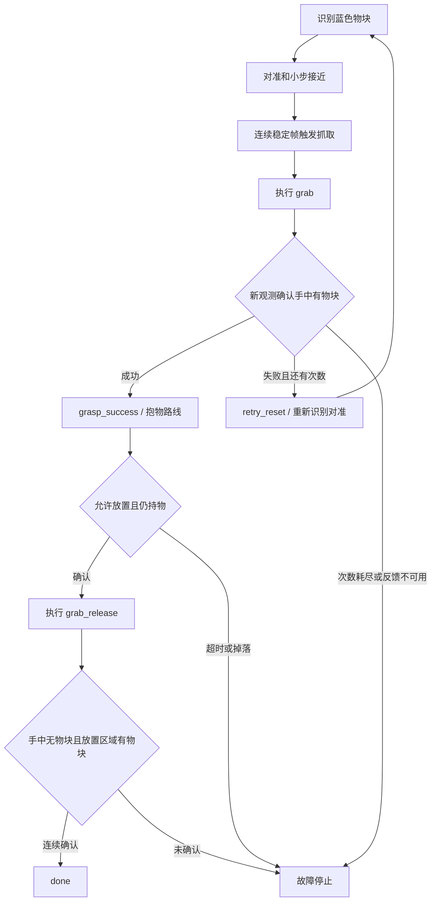

# 蓝色抓取、重抓、防碰撞和放置

## 当前实现及部署边界

`humanoid/ActionGroup/candidates/grab_turn_right.d6a` 已由抱物左转镜像腿部生成；`grab_release.d6a` 已由抓取倒序生成。两者是待验证候选，不能仅凭文件存在当作实机动作已验收。`retry_reset` 默认复用候选放下动作，必须验证它能从失败抓取的姿态安全返回重新识别姿态。请保留原始动作，调整候选后再复制到 Pi 的 ActionGroups 目录。

competition 已增加以下流程，动作仍由一个线程串行执行：



每个搬运动作结束后再次确认持物。搬运中掉落后停车，尚未实现掉落点定位和自动返回重抓；初始抓取失败的重抓机制已实现，默认最多 3 次。相机断流或没有有效反馈时进入故障，不会盲目重复抓取。

## 蓝色识别与 ROI 标定

配置已经改为 OpenCV HSV 的蓝色起始阈值：`[95,70,40]..[135,255,255]`。H 范围为 0..179，S/V 为 0..255。实际物块、白平衡和光照会影响阈值；需要在 Pi 画面上调整。也保留 LAB 模式，使用时设置 `color_space: LAB` 并填写 `lower_lab/upper_lab`。

只看相机和识别，不调用动作：

```bash
python3 humanoid/scripts/competition.py --vision-only --debug
```

Windows 使用 `python`；GUI 预览需要有窗口支持的 OpenCV，headless 包仅用于离线测试。

`feedback.held_roi` 是抓取结束并提起后，手中物块应出现的画面区域；`placed_roi` 是放下后物块应出现的地面/平台区域。使用归一化坐标 `[x0,y0,x1,y1]`，例如画面横向 100..200 像素、纵向 60..120 像素，在 320×240 图像上为 `[0.3125,0.25,0.625,0.5]`。这是计算示例，不是实际推荐区域。

两区域必须互不重叠，手中区域应排除地面原物块位置、蓝色衣物及背景。默认值为 null，实机启动会要求先标定。预览会画出已配置区域。`roi_min_area/roi_max_area` 是轮廓面积占所选 ROI 的比例，不是原图比例。

确认默认需要 6 个连续不同的新画面，抓取和放下动作结束前采集的画面不计入。视觉成功表示满足配置的空间颜色条件；它没有测量夹持力。需要做空抓、地面残留蓝块、遮挡、掉落和背景蓝色的负样本试验。如果相机看不到持物姿态或两区域不能分开，就使用外部反馈模式，不要填虚假的 ROI。

## 外部反馈接口和放置许可

`feedback.held/released` 可以设置 `mode: file`，填写各自反馈文件路径。传感器或视觉适配器必须持续写入真实观测，建议 20 Hz；同一时间戳重复读取不计作多次确认。JSON 格式：

```json
{"timestamp": 1791600000.123, "state": "held"}
```

timestamp 是采集时的 Unix 时间，示例时间不可直接复用。支持 `held/not_held`、`released/not_released`、`placement_ready/not_ready`。写入时先写临时文件，再原子替换；可复用 `distance_adapter.write_sample`，同一文件仅允许一个生产者。文件缺失、损坏、过期及状态未知不会确认成功；确认超时将停止。默认有效期 0.5 秒。

路线终点仍按现场标定的步数判断。**尚无指定终点标记识别器**，所以默认放置许可由操作员/外部终点检测适配器发出。在终点确认位置和平台高度正确、观察到程序进入 `checking_placement` 后，用另一个 Pi 终端执行：

```bash
python3 tools/feedback_signal.py --file /tmp/tonypi_placement.json --state placement_ready
```

这是真实人工确认，不是自动识别。旧许可不能用于新一轮确认；默认等待 30 秒，超时则保留当前姿态并报错。获得许可后会重新确认仍持物，再执行放下。仅看到手中蓝色消失不算放置成功，还必须看到放置区域的蓝色物块，才发布 done。放置失败不自动重复整套放下动作，避免从未知姿态继续动作。

## 防碰撞

`obstacle_guard` 默认开启。动作帧发送前、动作等待及反馈等待期间检查测距；距离不大于阈值、传感器无效或超过 0.3 秒未更新就停止、发布 fault，后车也会关闭运动许可。默认轮询 0.05 秒；这不是实测停止时间。

若使用官方 Hiwonder I²C 彩灯超声波，在 Pi 单独终端启动：

```bash
python3 humanoid/scripts/distance_adapter.py
```

适配器依据 [官方 Sonar SDK](https://github.com/Hiwonder/TonyPi/blob/dc452eaac9991516600860f706f4b889f3305d1d/HiwonderSDK/hiwonder/Sonar.py) 读取 mm 并转换为 m。断连返回 99999、0 和量程边界 5000 都作为无效输入停车，不会把断连误判成前方很远。此脚本仅适配该 I²C 模块；其他型号须按真实 SDK 提供以下接口：

```json
{"timestamp": 1791600000.123, "distance_m": 0.65, "valid": true}
```

默认 `stop_distance_m: 0.30` 只是起始值，必须根据传感器相对身体/双臂/物块的位置、动作最大伸出量和停止距离标定。目标物块也可能被测距检测到，需要结合抓取距离确定安装角度和阈值。单个前向超声波不覆盖侧面转弯摆幅、细杆和所有材质，不能保证所有方向不碰撞；现场通道净宽与动作包络仍需验证。TonyPi 尚未实现新障碍绕行规划，当前机制是检测危险后停止。

故障时尝试调用 SDK bus_servo_stop，保留力矩，不卸载舵机。老 SDK 没有对应停止接口时，最后一帧可能继续完成；中途停止步态也可能失稳，因此需要实测停止姿态和支撑条件。故障不会自动恢复路线。

## 调试顺序

1. 验证原始动作和候选右转、放下、重抓复位的衔接。
2. 标定蓝色阈值、接近条件、固定相机姿态及两种 ROI，测试空抓和遮挡。
3. 单独检查测距流、拔线停车、障碍阈值和停止动作，确认传感器确实覆盖路线。
4. 测试一次失败后成功、连续失败耗尽、搬运掉落及放置失败。
5. 完成动作和反馈验证，再设 `hardware_calibrated: true` 并联调后车。

配置：[competition.yaml](../humanoid/config/competition.yaml)。日志及 UDP 状态含 `verifying_grasp/grasp_success/grasp_failed/retrying/checking_hold/checking_placement/verifying_release`。ROS 桥已接受这些状态；后车在检查/重试状态中停车，仅在 carrying/releasing/done 时按自身目标与避障条件运动。
